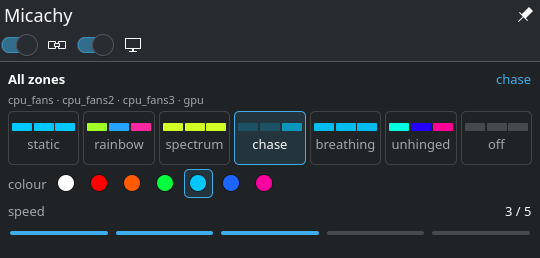
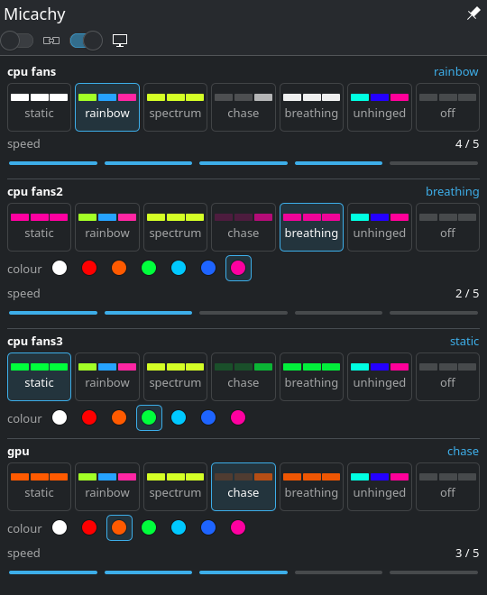

# Micachy

**CachyOS-native LED control for CPU cooler fans and GPU.**

A panel applet for the ARGB lighting on a CPU cooler's fans and a graphics
card, plus the cooler's built-in temperature display. It is built for
[CachyOS](https://cachyos.org/) on KDE Plasma specifically: it lives in the
panel the way Plasma's own tray popups do — click the bulb, get the popup,
nothing else to open — and its daemons are ordinary systemd user services.
Lighting reaches the motherboard headers over USB HID and the card over I2C on
the card itself, driven directly with no daemon in between; the cooler's
display is driven directly over HID with a protocol reverse-engineered for it.

Runs on **CachyOS** with **KDE Plasma 6**. It began as
[Mimarchy](https://github.com/villenull/Mimarchy), the same backend as an
Omarchy plugin, and still installs that way ([On Omarchy](#on-omarchy)).




Above: every zone linked, one shared set of controls. Below: unlinked, one
block per zone. Both are the applet itself — there is nothing behind it.

## What it does

- **Effects** — static, rainbow, spectrum, chase, breathing, and *unhinged*,
  all rendered in software from one clock so both devices stay in phase.
- **Linked or independent** — CPU and GPU move together by default; unlink to
  drive them separately.
- **A Plasma popup, not a window** — the same heading, pin and switches as the
  Bluetooth and Networks popups, in your desktop's own colours and font.
- **Cooler display** — streams live temperature and fan speed to the panel.

## Hardware

Developed against an ASUS PRIME X870-P WIFI, a Sapphire RX 9070 XT Nitro+, and
a Balam Rush Heliux Pro HEX75 cooler. `micachy-setup` finds your devices and
writes the config for you — it lists every detected zone, asks which ones to
drive and how long each strip is. `micachy-setup --list` prints what it sees
without changing anything, which is also the right thing to paste into a bug
report. The cooler display is specific to that USB device (`5131:2007`).

| Tier | What |
|---|---|
| Verified | ASUS PRIME X870-P WIFI headers, Sapphire RX 9070 XT Nitro+, Balam Rush HEX75 cooler display |
| Should work | several strips of different lengths; boards other than ASUS, given the same Aura USB protocol |
| Won't work | any cooler LCD other than `5131:2007`; firmware effects on hardware whose speed curve has not been measured (they run, at approximately the right rate) |

## Install

Clone it wherever you keep checkouts; everything below runs from there, and
nothing is copied out of it except the applet.

```bash
git clone https://github.com/villenull/micachy && cd micachy
```

**1. Device access.** The cooler display and the Aura controller sit on
root-only hidraw nodes, the one thing this cannot do for itself. Root writes
exactly the two lines you can read here — not a file from this user-writable
checkout (`udev/99-micachy.rules` keeps the same two lines for reference; a
test asserts they never drift). The card needs no rule: its LED controller
hangs off I2C adapters that already carry uaccess.

```bash
printf '%s\n' \
  'SUBSYSTEM=="hidraw", ATTRS{idVendor}=="5131", ATTRS{idProduct}=="2007", TAG+="uaccess", RUN{builtin}+="uaccess", GROUP="input", MODE="0660"' \
  'SUBSYSTEM=="hidraw", ATTRS{idVendor}=="0b05", ATTRS{idProduct}=="19af", TAG+="uaccess", RUN{builtin}+="uaccess", GROUP="input", MODE="0660"' \
  | sudo tee /etc/udev/rules.d/99-micachy.rules >/dev/null
sudo udevadm control --reload-rules
sudo udevadm trigger --action=add --subsystem-match=hidraw
```

Then unplug and replug the cooler, or reboot.

**2. Zones.** On hardware other than the reference set above, run the config
wizard before expecting light:

```bash
/usr/bin/python3 bin/micachy-setup
```

It lists every detected zone, asks which ones to drive and how long each
strip is, and writes the config; the lighting daemon picks the new file up
on its next poll. `/usr/bin/python3 bin/micachy-setup --list` prints what it
sees without changing anything, which is also the right thing to paste into
a bug report.

**3. Daemons and applet.**

```bash
cachyos/install-units     # lighting and cooler display, as systemd user services
cachyos/install-applet    # the panel applet
```

Then right-click the panel → Add or Manage Widgets → Micachy. Both scripts
take `--uninstall`, and [`cachyos/README.md`](cachyos/README.md) has the
details: logs, the lighting-only variant, and why the daemons take a few
seconds to appear after login.

**4. Fan speed** (optional) needs one kernel module loaded; see
[Fan RPM](#fan-rpm) below.

Uninstall: `cachyos/install-applet --uninstall`, `cachyos/install-units
--uninstall`, and delete the checkout. Optionally also remove the rule
(`sudo rm /etc/udev/rules.d/99-micachy.rules`, then reload udev).

### On Omarchy

The same checkout is an Omarchy 4 plugin, which is how this project started:

```bash
omarchy plugin add https://github.com/villenull/micachy --enable
```

That is the entire install: the panel starts the backend itself, from the
checkout Omarchy just cloned. `omarchy plugin update` keeps that checkout
current, so there is a single copy on disk.

The device-access rule in step 1 above is needed here too; the panel surfaces
it itself when the daemon reports it cannot open a device.

On hardware other than the reference set, run the config wizard before
expecting light. `bin/` is not on PATH, so it is invoked through the system
interpreter with the plugin path spelled out:

```bash
/usr/bin/python3 ~/.config/omarchy/plugins/io.github.villenull.micachy/bin/micachy-setup
```

It lists every detected zone, asks which ones to drive and how long each
strip is, and writes the config; the lighting daemon picks the new file up
on its next poll. `/usr/bin/python3 .../bin/micachy-setup --list` prints
what it sees without changing anything, which is also the right thing to
paste into a bug report.

Headless or no Omarchy desktop: run the backend directly from the checkout —
`/usr/bin/python3 bin/micachy-lightd` renders the lighting,
`/usr/bin/python3 bin/micachy-displayd` streams the cooler display, and
`/usr/bin/python3 bin/micachy-ctl status` (or `--json`) reports both.

Uninstall: `omarchy plugin remove io.github.villenull.micachy` stops the
panel and its daemons and removes the checkout. Optionally also remove the
rule (`sudo rm /etc/udev/rules.d/99-micachy.rules`, then reload udev);
nothing else was ever installed outside the plugin folder.

### Fan RPM

Requires Python 3.11+ and a running Wayland session; the backend itself is
stdlib-only, so there is nothing else to install. Fan RPM additionally needs
the kernel's own `nct6775` driver loaded — temperatures and lighting work
without it. Until it is loaded, `micachy-ctl status` says so by name rather
than dropping the reading:

    fan: NOT DETECTED — the nct6775 driver is not loaded, so no CPU fan
    sensor exists

The driver ships with the kernel, but the Super I/O chip has no PCI modalias,
so nothing loads it automatically and the plugin has no root to do it with.
It is one line, once:

```bash
printf 'nct6775\n' | sudo tee /etc/modules-load.d/nct6775.conf >/dev/null
sudo modprobe nct6775
```

Check it worked with `sensors | grep -A30 nct6799`, which should show `fan2`
(the CPU_FAN header) with a speed that rises under load. The cooler display
rounds RPM to the nearest 100.

**If you followed this README up to 0.6.0, undo it.** It used to prescribe the
out-of-tree `nct6687d` driver with `force=1`. That driver is for a different
chip; forced onto this board's NCT6799D it reports a constant 768 rpm that
never was a fan speed, and while it holds the chip `nct6775` cannot attach:

```bash
sudo rm /etc/modules-load.d/nct6687.conf
sudo rm /etc/modprobe.d/nct6687.conf      # if you set force=1 there
sudo pacman -R nct6687d-dkms-git
```

and drop `nct6687.force=1` from the kernel command line if you put it there.
`acpi_enforce_resources=lax` was part of the same advice. nct6775 has only
been verified here with it still set, so leave it until you have seen the
readings survive a boot without it.

> History note: up to 0.4.5 the lighting went through the OpenRGB SDK server.
> Since 0.5.0 both controllers are driven directly — raw hidraw writes for
> the board, I2C for the card — and OpenRGB is gone entirely.

### Omarchy desktop integration


**Omarchy 4.** The checkout above already is the plugin, so the bar widget
arrives with it: a bulb icon that dims when the LEDs are frozen, and a panel
with effect, colour and speed for every zone, plus toggles for the
cooler display and the link. Left click opens the panel, right click toggles
the display, middle click toggles the link. There is no second window behind
it — the panel is the entire interface, effects included.

A keybinding is worth adding too, for opening the panel without touching the
mouse. Every first-party Omarchy panel answers to the same idiom — `SUPER +
CTRL + B` for Bluetooth, `SUPER + CTRL + D` for Display, and so on — so this
follows it:

```lua
o.bind("SUPER + CTRL + M", "Micachy", "omarchy-shell shell toggle io.github.villenull.micachy")
```

in `~/.config/hypr/hyprland.lua`. `SUPER + CTRL + <letter>` is claimed for
every letter except `G`, `J`, `M`, `U` and `Y` — checked against every binding
in `/usr/share/omarchy/default/hypr/bindings/*.lua` (`utilities.lua`,
`applications.lua`, `clipboard.lua`, `media.lua`, `tiling.lua`,
`voxtype.lua`). `M` is the one that reads as this plugin's name; pick another
free letter if your own config has already claimed it.

One optional extra:

| File | Merge into | Gives you |
|---|---|---|
| [`omarchy/micachy-menu.jsonc`](omarchy/micachy-menu.jsonc) | `~/.config/omarchy/extensions/omarchy-menu.jsonc` | Micachy in the Omarchy menu and its search |

## Keys

With the Plasma popup open:

| Key | Action |
|---|---|
| `1`–`6` | set static / rainbow / spectrum / chase / breathing / unhinged |
| `0` | set off |
| `+` `-` | speed up / down, every zone |
| `u` | link / unlink all zones |
| `d` | cooler display on / off |
| `Escape` | close the popup |

The number keys act on the first zone block, which while linked is the only
one there is. Middle-clicking the bulb links and unlinks without opening
anything.

### Omarchy panel keys

The panel takes a keyboard cursor, the same way Omarchy's other bar panels do:
open it, then move without ever touching the mouse.

| Key | Action |
|---|---|
| `h` `j` `k` `l`, arrow keys | move the cursor |
| `Enter` / `Space` | activate whatever the cursor is on |
| `1`–`6` | set the cursor's zone to static / rainbow / spectrum / chase / breathing / unhinged |
| `0` | set the cursor's zone to off |
| `+` `-` | speed up / down, every zone |
| `u` | link / unlink all zones |
| `d` | cooler display on / off |
| `Escape` | close the panel |

`1`–`6` and `0` are scoped to wherever the cursor is standing: with the cursor
on the GPU's effect row, pressing `3` sets the GPU to spectrum without
touching anything linked to it. `u`, `d`, `+` and `-` stay global regardless of
the cursor — `u` and `d` mirror the icon's own middle- and right-click, and
`+`/`-` are the coarse every-zone speed nudge (the icon's scroll wheel does
nothing; there is no zone for a scroll to pick). Keeping these four global
means the same keystroke never means two different things depending on a
cursor the user may not have summoned yet. The first press of a movement key
only reveals the cursor rather than moving it, so it never jumps in from
off-screen.

## micachy-ctl

The panel is not the only interface. `micachy-ctl` drives the same state from
a script, a Hyprland keybinding, an SSH session, or a machine with no Omarchy
desktop at all — and it is exactly what the panel itself calls, rather than
reaching into the state file directly.

```bash
/usr/bin/python3 bin/micachy-ctl status            # or --json, which is what the widget reads
/usr/bin/python3 bin/micachy-ctl effect rainbow
/usr/bin/python3 bin/micachy-ctl speed +           # or -
/usr/bin/python3 bin/micachy-ctl colour accent     # follow the theme; or green, red, ... or #ff0044
/usr/bin/python3 bin/micachy-ctl display toggle    # on / off / toggle
/usr/bin/python3 bin/micachy-ctl link toggle
```

(From the plugin checkout; `bin/` is not on PATH, so the system interpreter
is named outright.)

Writes go through an atomic write-then-rename, so a panel click and a scripted
write cannot interleave into a half-written file. Nothing here talks to
hardware; `micachy-lightd` still owns that.

`status` also reports what the daemon actually found: a configured zone whose
controller did not answer shows as `gpu: NOT DETECTED` (and as `missing_zones`
in the JSON), next to the state that would otherwise look healthy. The daemon
logs the same line when it starts, after waiting a bounded 20 s for a
controller that is merely slow to appear.

### Lighting that follows your theme

Omarchy only for now: the colours are read from Omarchy's theme directory,
which Plasma does not have, so the Plasma applet offers the fixed colours.

Give a colour a *role* — `accent`, `red`, `orange`, `yellow`, `green`, `cyan`,
`blue`, `magenta` — instead of a value, and it re-resolves whenever you change
Omarchy themes. In the panel, `theme` is the first chip in each zone's swatch
row, ahead of the seven fixed colours. The state file stores the role, so it
keeps following across reboots.

The lighting daemon keeps a hook in `~/.config/omarchy/hooks/theme-set.d/`
pointing at `omarchy/theme-set.d/micachy`, which calls
`bin/micachy-ctl reload-theme` after a theme switch; the daemon picks the new
colour up on its next frame, so the strips change with the wallpaper rather than
on the next reboot. Fixed hex colours are never touched by it.

Theme colours are used as authored, with one exception: a colour dimmer than
55% brightness is lifted to that floor, hue and saturation untouched. Measured
across the 22 stock themes, that lifts 17 of 173 colours and leaves 156 exactly
as the theme author set them — a floor rather than a scale, so a deliberately
muted theme still looks muted on the strip.

## Notes

Lighting only animates while the lighting daemon runs; stopping it freezes
the LEDs on their last frame. The cooler display has no off command in its
protocol — `d` stops the telemetry stream, and the panel blanks itself about 50
seconds later.

[docs/hardware-notes.md](docs/hardware-notes.md) covers the parts that were not
obvious: why zone sizing is mandatory, why effects are rendered rather than run
on the controllers, how the display protocol was worked out, and every
measurement behind those decisions.

## License

[MIT](LICENSE).
